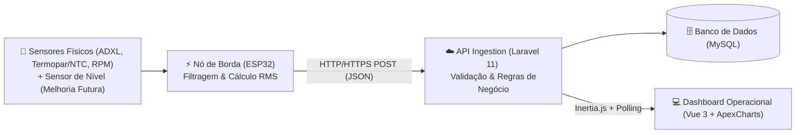

# ⚙️ Plataforma IoT para Manutenção Preditiva na Indústria 4.0

> **Desenvolvimento de uma plataforma IoT para manutenção preditiva pautada em análise de vibração e temperatura na indústria 4.0**

<p align="center">
  
  
  
  
  
  
  
</p>

Plataforma de **Internet das Coisas Industrial (IIoT)** voltada para observabilidade em tempo real, computação de borda (*Edge Computing*) e **manutenção preditiva baseada em condição (CBM)** para motores elétricos de indução em maquinários de usinagem industrial.

---

## 📌 Contexto e Aplicação Industrial

- **Ativo Monitorado:** Torno Revólver AMA TR4 (operação mecânica sujeita a estresse cíclico e corte contínuo).
- **Parceiro / Local de Aplicação:** Steelbras Antenas Indústria e Comércio LTDA (Matriz: Presidente Prudente - SP).
- **Problema Abordado:** Reduzir paradas não planejadas de produção (*downtime*), mitigar riscos operacionais e prevenir falhas catastróficas em rolamentos e componentes mecânicos de motores de indução através do monitoramento contínuo de vibração, temperatura, rotação (RPM) e nível de fluido (previsto como melhoria futura).

---

## 🎯 Objetivos

- **Objetivo Geral:** Desenvolver e implementar uma solução completa de telemetria e análise preditiva de borda para nuvem, garantindo a supervisão contínua da saúde mecânica e térmica de maquinários industriais críticos.
- **Objetivos Específicos:**
  - Coletar dados físicos em tempo real por meio de nó de borda com microcontrolador ESP32 e sensores industriais.
  - Processar e filtrar sinais no próprio dispositivo (*Edge Computing*), calculando métricas como RMS e picos para otimizar o envio de pacotes de rede.
  - Ingerir e validar leituras através de uma API REST robusta desenvolvida em Laravel.
  - Classificar dinamicamente o status operacional do maquinário (**NORMAL**, **ATENÇÃO** ou **CRÍTICO**).
  - Disponibilizar um painel de visualização reativo com gráficos de séries temporais triaxiais (ApexCharts) e alertas visuais automáticos.

---

## 🌐 Arquitetura do Sistema (Edge-to-Cloud)



1. **Camada de Borda (Edge Layer - ESP32):**
   - Aquisição de dados de acelerômetros triaxiais (ADXL), sensores de temperatura e pulsos de rotação (RPM).
   - Extração de características em tempo real (média, máximas e RMS), reduzindo a sobrecarga de transmissão na rede industrial.
   - *Nota:* O suporte lógico ao campo `nivel_fluido` já existe no backend e dashboard, mas a integração física do sensor de nível no ESP32 ainda não foi implementada (marcada como melhoria futura).

2. **Camada de Ingestão e Nuvem (Cloud Layer - Laravel):**
   - API REST segura com validação de integridade e ingestão de dados em alta frequência.
   - Mapeamento e persistência no banco relacional MySQL.
   - Motor de regras para classificação dinâmica dos estados operacionais.

3. **Camada de Apresentação (Frontend Reativo - Vue 3 + Inertia.js):**
   - Interface limpa com tema escuro (*dark mode*) desenvolvida com Tailwind CSS.
   - Gráficos em tempo real com Vue ApexCharts (curvas de temperatura e vibração triaxial nos eixos X, Y e Z).
   - Atualização automática contínua via *polling* assíncrono sem recarregamento da página.

4. **Ambiente de Simulação e Testes (Python):**
   - Script `simular_iot.py` para injeção de telemetrias simuladas e testes de estresse de ingestão.

---

## 📊 Matriz de Telemetria e Limiares Operacionais

A classificação automática de risco do ativo segue as normas e limites de tolerância mecânica:

| Grandeza | Normal | Atenção | Crítico | Impacto / Diagnóstico |
| :--- | :---: | :---: | :---: | :--- |
| **Temperatura (°C)** | $\le$ 60,0 °C | 60,1 °C a 75,0 °C | > 75,0 °C | Degradação de lubrificação / Falha iminente de rolamento |
| **Vibração Triaxial ($m/s^2$)** | $\le$ 1,50 | 1,51 a 2,50 | > 2,50 | Folga estrutural, desbalanceamento ou desalinhamento de eixo |
| **Velocidade de Rotação (RPM)** | Contínuo | - | - | Mapeamento de regime de corte e esforço mecânico |
| **Nível de Fluido** *(Melhoria Futura)* | `OK` | - | `FALHA` | Nível crítico de lubrificação/refrigeração *(sensor físico a ser implementado)* |

---

## 🛠️ Tecnologias Utilizadas

- **Backend:** [PHP 8.3+](https://www.php.net/), [Laravel 11.x](https://laravel.com/), [Laravel Sanctum](https://laravel.com/docs/sanctum), [Laravel Breeze](https://laravel.com/docs/starter-kits#laravel-breeze).
- **Frontend:** [Vue.js 3](https://vuejs.org/) (Composition API), [Inertia.js](https://inertiajs.com/), [Tailwind CSS](https://tailwindcss.com/), [ApexCharts](https://apexcharts.com/).
- **Banco de Dados:** [MySQL](https://www.mysql.com/) / [SQLite](https://www.sqlite.org/).
- **Hardware / Edge IoT:** Microcontrolador ESP32, Sensores Acelerômetros (ADXL345), Sensores de Temperatura e Tacômetro Óptico/Indutivo.
- **Ferramentas de Simulação:** [Python 3](https://www.python.org/) (`requests`).

---

## 🧪 Simulação de Telemetria IoT

Para simular o envio contínuo de leituras do ESP32 para a API em ambiente local:

```bash
# Instale a dependência de requisições caso necessário
pip install requests

# Execute o simulador
python3 simular_iot.py
```

O script enviará leituras com variações realistas de temperatura, vibração nos 3 eixos para múltiplos acelerômetros, RPM e status operacional a cada 5 segundos.

---

## 🚀 Melhorias Futuras

- [ ] **Implementação do Sensor Físico de Nível de Fluidos:** A arquitetura de software (migrations, API REST, models e dashboard Vue) já está preparada para monitorar o estado do reservatório de corte/lubrificação (`OK` ou `FALHA`). Contudo, o sensor físico de nível de fluidos ainda não foi integrado ao circuito de hardware do ESP32 nesta versão do protótipo, estando catalogado como uma melhoria futura prioritária.

---

## 🏫 Instituição

**Universidade Virtual do Estado de São Paulo — UNIVESP**  
- **Curso:** Engenharia da Computação  
- **Disciplina:** Projeto Integrador VI (PI VI)  
- **Ano:** 2026  
- **Polos:** Presidente Prudente, Rosana e Teodoro Sampaio - SP  
- **Empresa Parceira:** Steelbras Antenas Indústria e Comércio LTDA (Presidente Prudente - SP)  
- **Ativo Monitorado:** Torno Mecânico Revólver AMA TR-4  

---

## 👥 Integrantes

- Barbara Sthefani Leite Silva
- Gustavo da Silva Aguiar Ribeiro
- Henrique Mendes Ferro da Silva
- João Augusto Caminhoto
- Leonardo de Oliveira Lopes
- Mayara Ribeiro Brite
- Renan Fortaleza de Carvalho

**Orientadora:** Moniely Silva Barboza  

---

## 📄 Licença

Este projeto é desenvolvido para fins acadêmicos e educacionais no âmbito do Projeto Integrador da UNIVESP.
